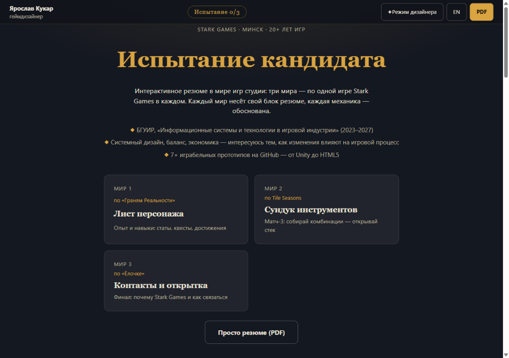
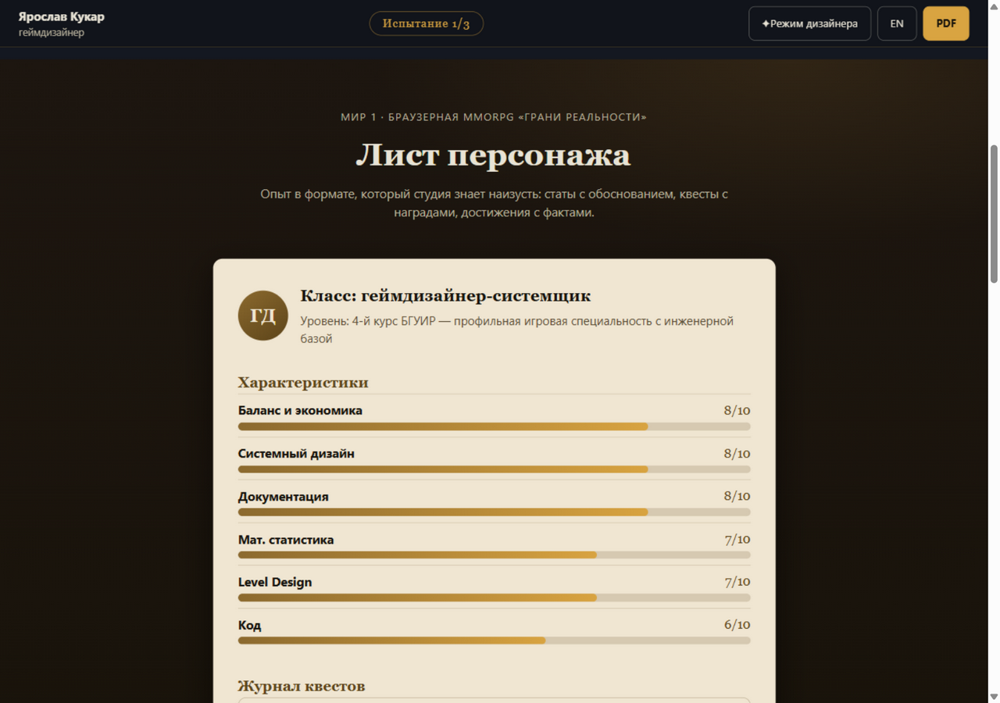
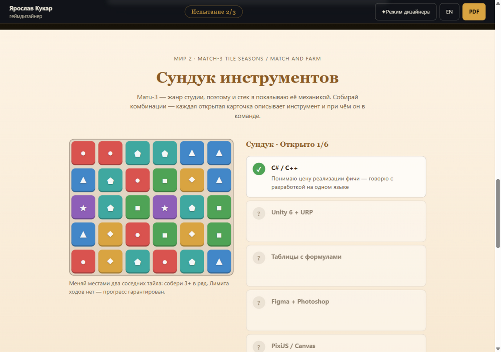
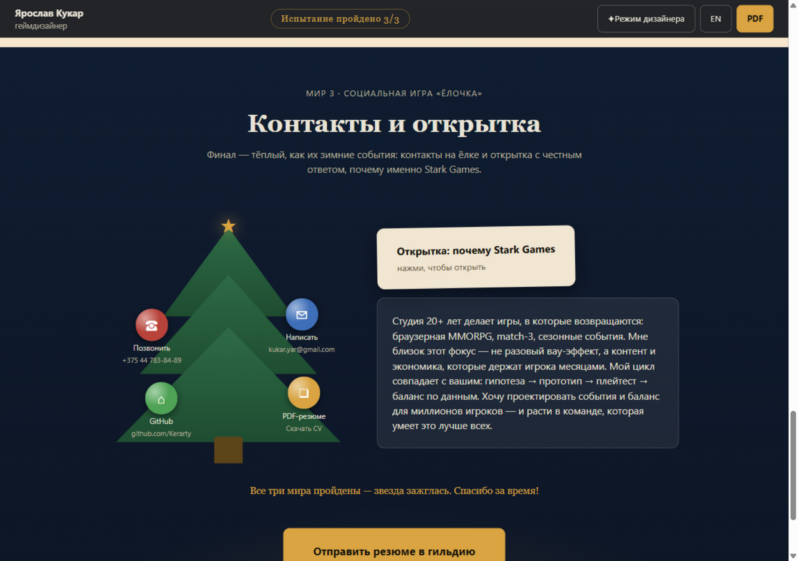
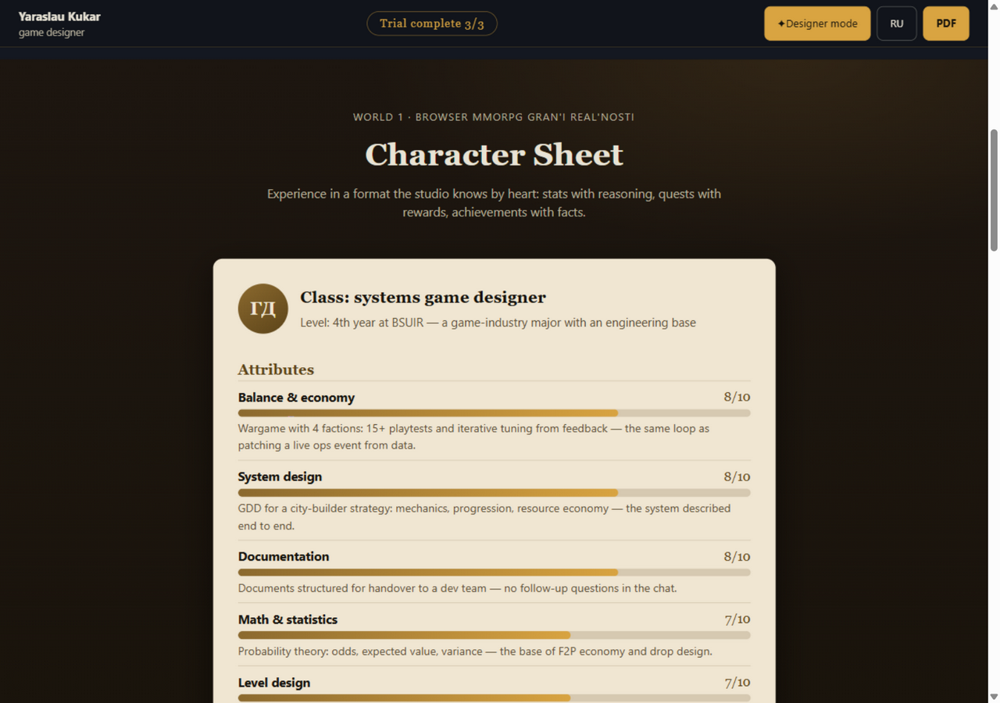
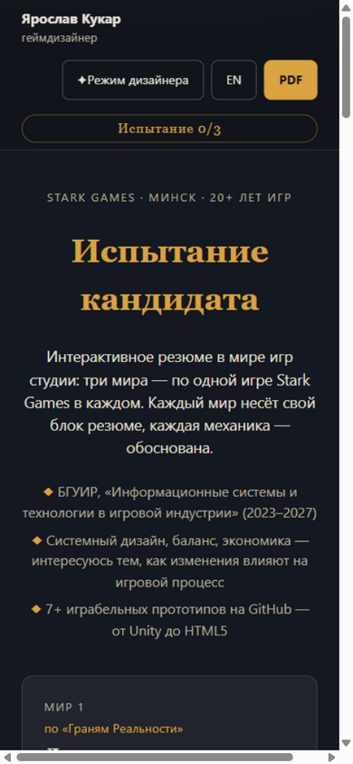

# Испытание кандидата — резюме для Stark Games

Интерактивное резюме геймдизайнера в мире игр [Stark Games](https://stark.games): три мира — по одной игре студии в каждом. Вместо списка достижений — механики, каждая из которых несёт конкретный блок резюме.

Живая версия: https://kerarty.github.io/cv-stark-games/



## Зачем

Резюме уходит по инициативе, без открытой вакансии, поэтому его задача — за 30 секунд дать HR три ответа: кто это, что умеет и почему именно к нам. Обычный PDF на это не способен, а резюме, построенное на играх самой студии, отвечает на все три сразу: кандидат знает их портфолио, умеет маппить механики на контент и уважает время рекрутера.

Каждый проект подан через задачи студии: варгейм с 15+ плейтестами — как цикл правки live ops события, баланс ресурсов из GDD — как экономика match-3, playable-реклама в 472 КБ — как их формат лёгких HTML5-игр.

## Как устроено

Три мира — три игры студии:

- **Мир 1. «Грани Реальности»** — лист персонажа в их браузерной MMORPG: статы с обоснованием, журнал квестов (варгейм «Королевства Эридора», GDD стратегии, echoloop) и достижения с фактами
- **Мир 2. Tile Seasons** — сундук инструментов: матч-3, где каждая собранная комбинация открывает карточку стека (C#, Unity 6, таблицы с формулами, Figma, PixiJS, Git)
- **Мир 3. «Ёлочка»** — тёплый финал: контакты-шары на ёлке, открытка «почему Stark Games» и кнопка личной почты kukar.yar@gmail.com





Прогресс «Испытание N/3» в HUD растёт при посещении миров; после всех трёх на ёлке зажигается звезда.

## Что умеет

- **Режим дизайнера** — тумблер, раскрывающий обоснование каждого решения: почему RPG-лист, почему матч-3 без лимита ходов, почему ёлка. Резюме само объясняет свои механики



- переключатель RU/EN — весь текст, включая HUD и обоснования
- честная матч-3: свайп или клик, каскады, гравитация, тряска неверного свапа и автоперемешивание тупиковых полей — но без лимита ходов, прогресс гарантирован
- мобильная версия: HR откроет с телефона, всё играется пальцем



- печатная версия: `@media print` превращает страницу в обычное текстовое резюме, игры скрыты, все блоки раскрыты
- PDF-версия ([assets/Yaroslav_Kukar_CV.pdf](assets/Yaroslav_Kukar_CV.pdf)) — для тех, кто не играет; кнопка в HUD и на ёлке

## Запуск

Статика без сборки и зависимостей — открыть `index.html` в браузере. Локальный сервер:

```bash
python -m http.server 8123
```

## Структура

| Файл | Что это |
|---|---|
| `index.html` | Каркас. Только контейнеры, весь текст — в `content.js` |
| `styles.css` | Темы трёх миров, токены 8px-сетки, `@media print` |
| `content.js` | Весь текст, русский и английский. Править только его |
| `games.js` | Мини-движок матч-3: свап, матчи, каскады, гравитация |
| `main.js` | Язык, рендер, режим дизайнера, прогресс испытания |
| `docs/GDD.md` | Гейм-дизайн-документ самого резюме |
| `docs/content.md` | Контент и карта «мой опыт → их задачи» |
